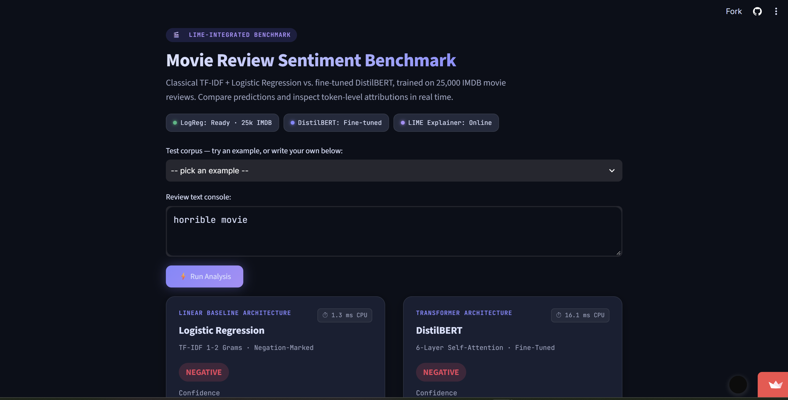
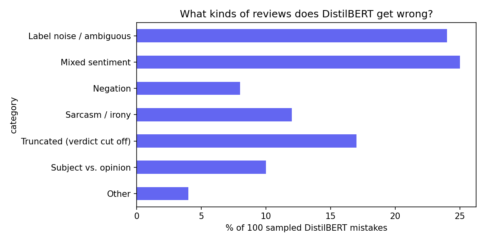

# Movie Review Sentiment: Where Do Classical and Transformer Models Break?

Built during the Wheeltrix Data Science & Analytics internship.

I trained a classical model (TF-IDF + logistic regression) and a fine-tuned DistilBERT on IMDB reviews,
then went beyond accuracy: cross-domain tests, a behavioural test suite, word-level explanations (LIME),
an attempt to fix the baseline, and an error taxonomy.



**Live demo:** [Try the app](https://sentiment-movie-review-analysis-u55xlkh4binccbztv22c4c.streamlit.app/) &nbsp;|&nbsp; **Model:** [DistilBERT on Hugging Face](https://huggingface.co/sidratahseen/distilbert-imdb-sentiment)

## Key findings

1. **DistilBERT wins, but narrowly on in-domain data.** 91.3% vs 90.5% accuracy on the IMDB test set.
2. **The gap widens out of domain.** Trained on IMDB only, DistilBERT leads by 4.1 points on Rotten Tomatoes
   and 7.6 on SST-2 (paired bootstrap 95% CIs exclude 0 in all three cases).
3. **The two models fail differently.** The bag-of-words baseline cannot compose "not" with the next word.
   DistilBERT handles most negation but can lock onto one strong word and miss sarcasm or idiom.
4. **A fix that did not work is reported as such.** Removing stopwords cost about 1 point of accuracy and did not
   fix the failure that motivated it. Negation marking did help (see below).
5. **Short inputs are out of distribution.** The median IMDB training review has 173 words, so one-word inputs
   leave the baseline with almost nothing to go on. The demo shows UNCERTAIN instead of forcing a label.

## Results

### In-domain (IMDB test, 25,000 reviews)

| Model | Accuracy | F1 |
|---|---|---|
| TF-IDF + Logistic Regression | 90.5% | 0.905 |
| TF-IDF + Linear SVM | 90.7% | 0.907 |
| DistilBERT (2 epochs) | 91.3% | 0.914 |

### Cross-domain (trained on IMDB only, no adaptation)

| Test set | Logistic Regression | DistilBERT | Difference (95% CI) |
|---|---|---|---|
| IMDB (in-domain) | 90.5% | 91.3% | +0.8 pts (+0.4, +1.2) |
| Rotten Tomatoes (test) | 76.6% | 80.7% | +4.1 pts (+1.1, +6.8) |
| SST-2 (validation) | 78.7% | 86.2% | +7.6 pts (+4.7, +10.3) |

### Behavioural tests (hand-built, small, so treat as diagnostic rather than a benchmark)

100 templated negation cases, accuracy by group:

| Group | Logistic Regression | DistilBERT | LR + negation marking |
|---|---|---|---|
| Negated positive ("not good") | 68% | 100% | 100% |
| Negated negative ("not bad") | 0% | 65% | 0% |
| Plain positive (control) | 50% | 100% | 60% |
| Plain negative (control) | 100% | 100% | 100% |

A separate 28-case hand-written suite (negation, sarcasm, mixed, typos, short) is too small to rank the models;
it is used only to find failure modes.

### Attempts to improve the baseline

| Variant | IMDB test | Rotten Tomatoes test | Negation suite |
|---|---|---|---|
| A. Original | 90.5% | 76.6% | 42% |
| B. + negation marking (`not good` -> `not NOT_good`) | 90.8% | 76.9% | 56% |
| C. + Rotten Tomatoes training snippets | 90.7% | 81.8% | 44% |
| D. B + C | 90.8% | 81.5% | 56% |
| Stopword removal (negations kept) | 89.4% | n/a | 36% |

Notes: variants C and D were trained on Rotten Tomatoes data, so their Rotten Tomatoes score is in-domain
and not comparable to DistilBERT's zero-shot number. SST-2 is excluded for them because it shares source
snippets with Rotten Tomatoes. Negation marking fixed "not good" but not "not bad".

### Why does the baseline say "i hate it" is positive?

The word "hate" has a coefficient near zero (it appears in 696 training reviews, 43% labelled positive),
while the function word "it" has a large positive coefficient. Short inputs like this are very far from the
long reviews the model was trained on. No variant fixed this case.

### Error taxonomy (100 random DistilBERT mistakes on the IMDB test set)

Re-evaluating the fine-tuned model on the 25,000 test reviews gave 91.2% accuracy and 2,191 mistakes
(1,226 false positives and 965 false negatives). I sampled 100 mistakes at random (fixed seed) and
hand-labelled each with one primary category.

| Category | Count | % (95% CI) |
|---|---|---|
| Mixed sentiment | 25 | 25% (18-34%) |
| Label noise / ambiguous | 24 | 24% (17-33%) |
| Truncated (verdict cut off) | 17 | 17% (11-26%) |
| Sarcasm / irony | 12 | 12% (7-20%) |
| Subject vs. opinion | 10 | 10% (6-17%) |
| Negation | 8 | 8% (4-15%) |
| Other | 4 | 4% (2-10%) |



**What this shows**

- About half of the sampled mistakes (49%) were mixed-sentiment or label-noise/ambiguous reviews, where
  even a careful human reader could disagree with the label. These are partly a limit of the data, not
  only of the model.
- Truncation is the most fixable category. 55 of the 100 sampled reviews were longer than the 256-token
  limit, and in 17 of them the verdict appeared to be in the part the model never saw. Raising the maximum
  length is the obvious next experiment, though I have not tested it.
- Sarcasm and negation together are only 20% of mistakes, so they matter less for IMDB accuracy than the
  behavioural tests might suggest. They are still real failure modes: sarcasm errors were mostly false
  positives (8 of 12), which fits sarcastic praise containing positive words in a negative review.
- 47 of the 100 sampled mistakes were made with at least 95% confidence. The UNCERTAIN label in the demo
  only catches near coin-flip predictions, so it would not flag these confident mistakes.
- With 100 sampled mistakes the shares are rough: the 95% intervals are about ±8-9 points for the larger
  categories, so the ordering of neighbouring categories (for example mixed sentiment vs. label noise)
  should not be over-interpreted. The categories are my own judgement, from a single labeller.


## Method

- **Data:** IMDB (25k train / 25k test) from Hugging Face `stanfordnlp/imdb`. Cross-domain: Rotten Tomatoes
  and SST-2 validation.
- **Baseline:** TF-IDF (1-2 grams, min_df=3, sublinear tf) + logistic regression (C=4).
- **Transformer:** `distilbert-base-uncased`, 2 epochs, max length 256, learning rate 2e-5, batch size 16.
  Single training run, no hyperparameter search.
- **Explanations:** LIME (500 perturbed samples per prediction) rendered as word highlights.
- **Evaluation:** the test set was used only for reporting. Confidence intervals use bootstrap resampling.

## Limitations

- Sarcasm is not solved by either model, and I did not try to solve it.
- Reviews are truncated at 256 tokens for DistilBERT; some mistakes come from the model never seeing the ending.
- The behavioural suites are small and partly templated. They show failure modes, not rates.
- One training run per model; I did not measure run-to-run variance.
- The UNCERTAIN threshold (confidence below 60%) in the demo is a design choice, not a calibrated value.
- Latency numbers (roughly 1-3 ms for logistic regression vs 30-40 ms for DistilBERT per review on a laptop CPU)
  are informal single measurements.

## Run it yourself

```bash
pip install -r requirements.txt
streamlit run app.py
```

The app loads `logreg_negation_pipeline.joblib` from this folder and downloads the [DistilBERT model](https://huggingface.co/sidratahseen/distilbert-imdb-sentiment) from the Hugging Face Hub.

## Repository layout

```
app.py                              Streamlit demo
requirements.txt
logreg_negation_pipeline.joblib     classical baseline (negation marking + Rotten Tomatoes snippets)
notebooks/                          Colab notebook(s): training, evaluation, error taxonomy
results/                            figures and tables (e.g. error_taxonomy.png)
README.md
```
